# 🧠 Local Legal AI

A private, self-hosted assistant for **law firms**: upload contracts, filings and
policies, then ask questions and get answers that cite the exact passages they
came from. Everything — documents, vectors, the language model — stays on your
machine. No third-party AI APIs are called.

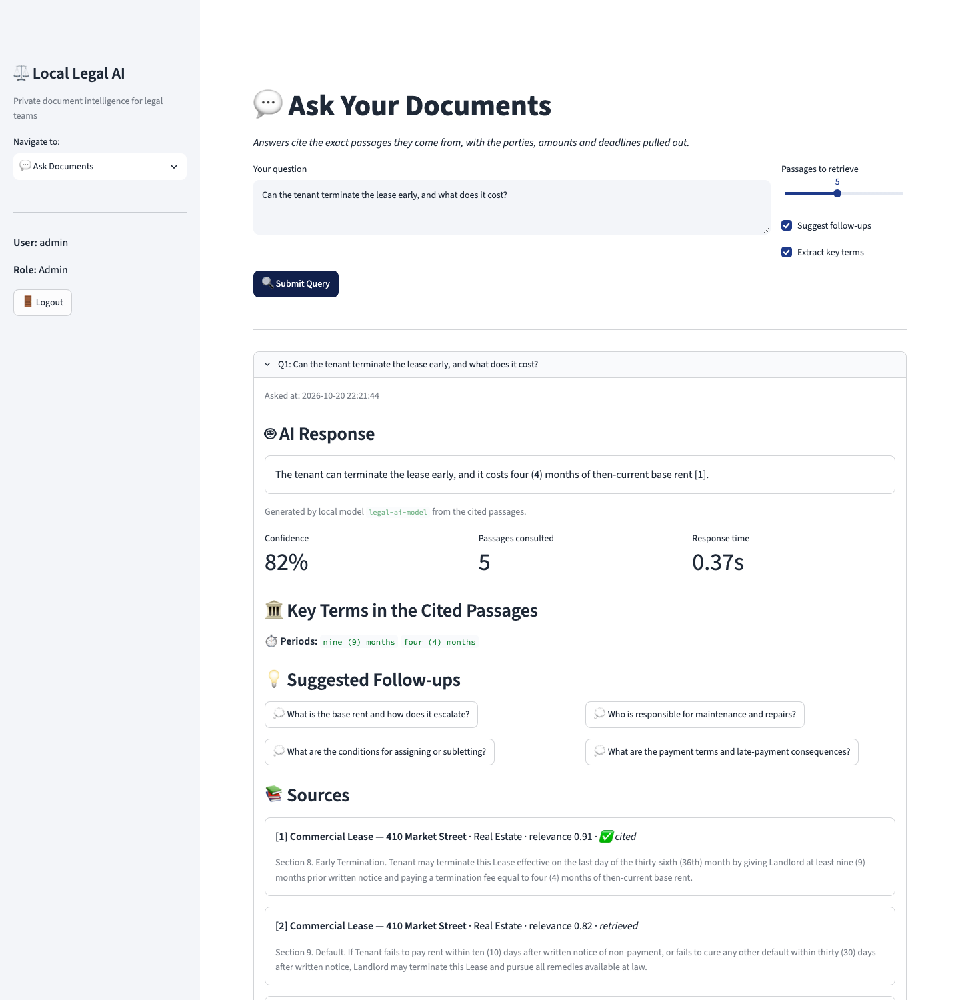

## 🚀 Features

| Feature | Status |
|---|---|
| 🔐 Local login (JWT, bcrypt) with admin, lawyer and user roles | ✅ |
| 👥 User administration, forced first-login password change, instant session revocation | ✅ |
| 📄 PDF, DOCX and TXT ingestion with legal document-type detection | ✅ |
| 📚 Semantic search over an embedded ChromaDB store | ✅ |
| 🧾 Cited answers from a local LLM (llama.cpp, Ollama or vLLM), streamed word by word | ✅ |
| 🧭 Grounding guard: off-topic questions are refused, uncited answers are flagged | ✅ |
| 🪶 Extractive answer mode when no model is running (no GPU required) | ✅ |
| 🏛 Key-term extraction (parties, amounts, periods, dates, governing law) and follow-up suggestions | ✅ |
| 🗂 Document library: per-document listing, search, delete | ✅ |
| 📊 Admin analytics: usage, query types, latency, document similarity, user activity | ✅ |
| 🛡 Tamper-evident audit log (hash-chained) with filters and CSV export | ✅ |
| 🌐 IP whitelisting (addresses or CIDR ranges) | ✅ |
| 📥 Watched-folder ingestion: drop files in `data/inbox/` and they're indexed | ✅ |
| 🔁 n8n automation and Slack alerts (signed webhooks, 3 ready-made workflows) | ✅ |

Progress and the remaining roadmap live in [`phases.md`](phases.md).

## 📸 Tour

All screenshots come from a fresh instance loaded with the fictional sample
agreements in [`samples/`](samples/) (see [Try it with sample data](#-try-it-with-sample-data)).
Answers were generated on the same laptop by Qwen2.5-1.5B-Instruct running
under llama.cpp (`bash model/llamacpp_launcher.sh`), served as `legal-ai-model`.

### Sign in
A local login page. Credentials are checked by the API (bcrypt + JWT); nothing
leaves the machine.

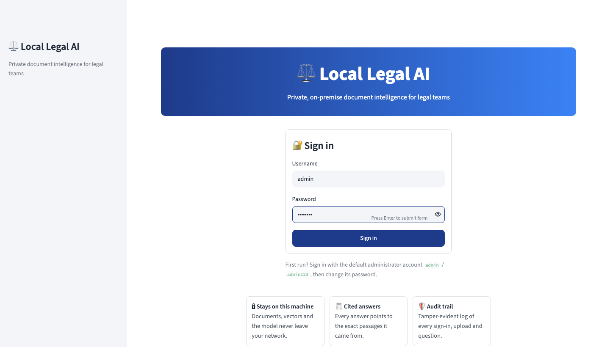

### Dashboard
Live library metrics, whether a local model is connected, and the most recently
added documents.

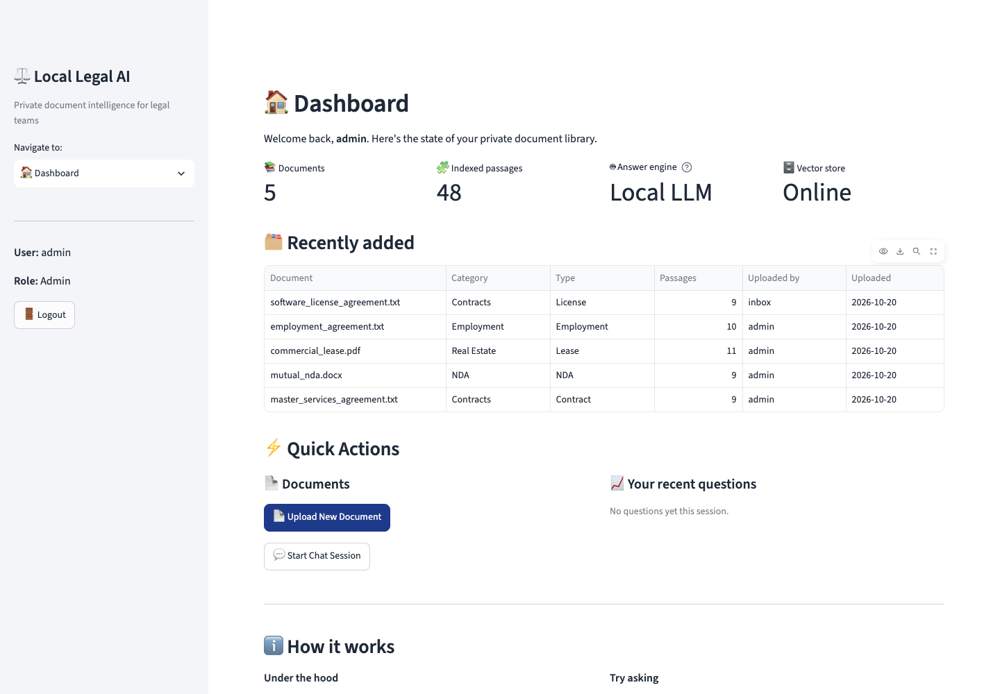

### Upload documents
PDF, DOCX and TXT. Each file is parsed, its document type detected, split clause
by clause and indexed locally; a preview is shown before processing.

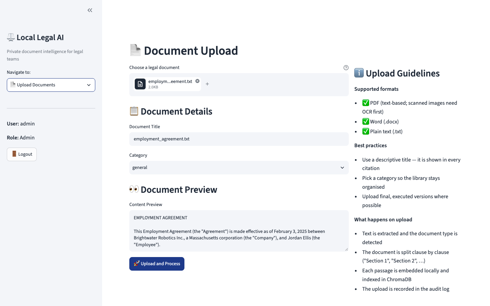

### Ask your documents
Answers stream in word by word as the local model writes them, and every
sentence cites a numbered passage. Parties, amounts, notice periods, dates and
governing law found in the cited text are pulled out, and follow-up questions
are suggested for the document types involved. Questions the library doesn't
cover are refused rather than answered from the model's general knowledge.
(Full-size view at the top of this page.)

### Document library
Documents grouped by category with search, details and delete (uploader or admin).

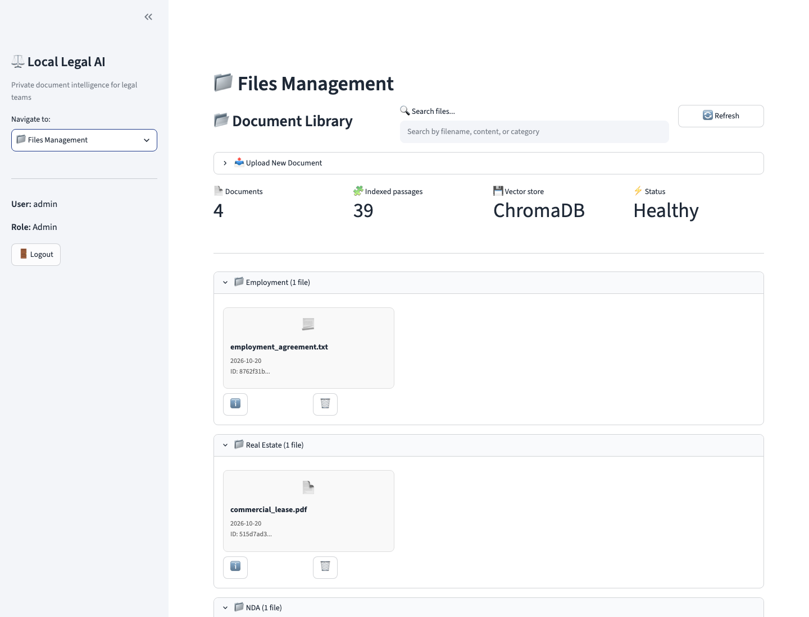

### Analytics (admins)
Built from real usage — no sample numbers.

| Usage and query mix | Response time and retrieval quality |
|---|---|
| 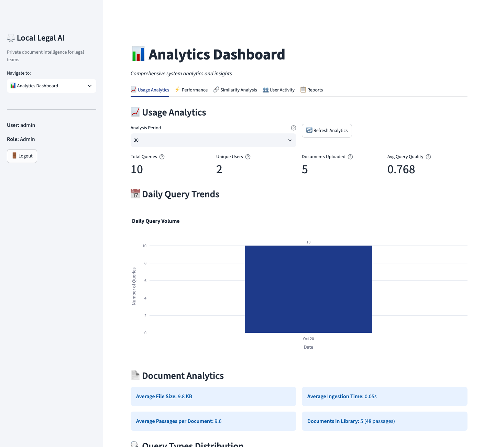 | 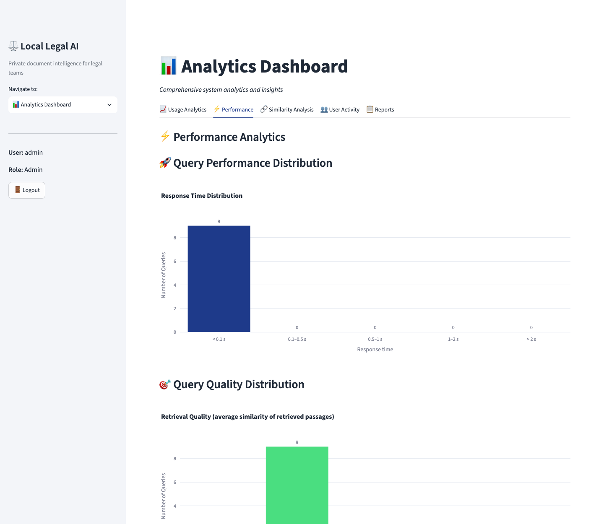 |
| **Document similarity** | **User activity** |
| 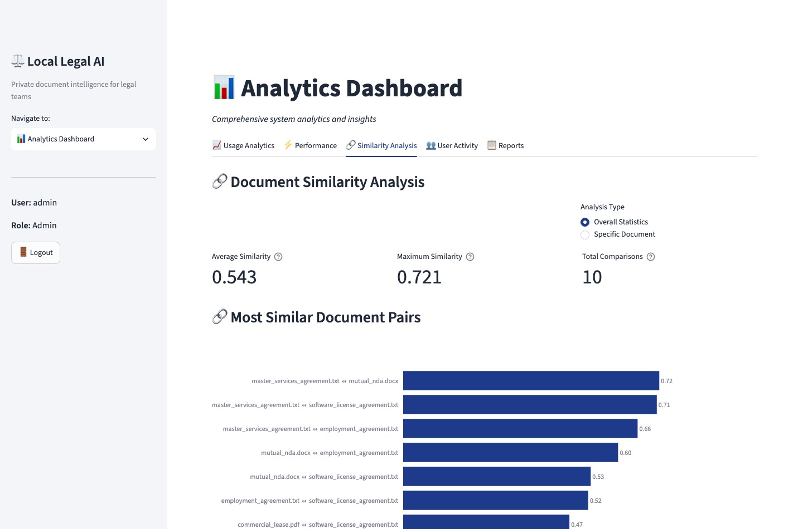 | 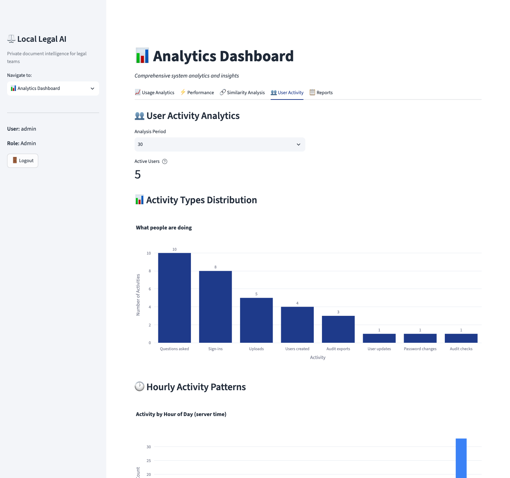 |

### Audit log (admins)
Every sign-in (including failures), upload, question, deletion and export, each
linked to the previous one by a SHA-256 hash so edits are detectable. Filter,
verify the chain in one click, and export to CSV.

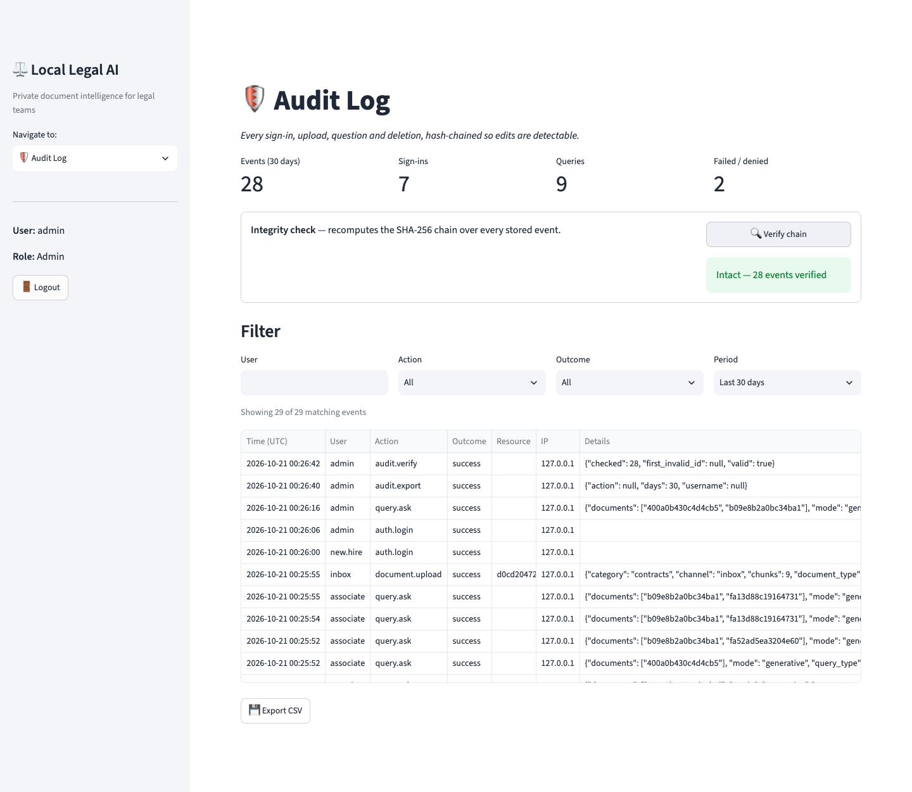

### User administration (admins)
Add colleagues with a temporary password, change roles (admin, lawyer, user),
disable leavers and reset forgotten passwords. Disabling an account, changing its
role or resetting its password signs that person out everywhere. The last active
administrator can't be removed.

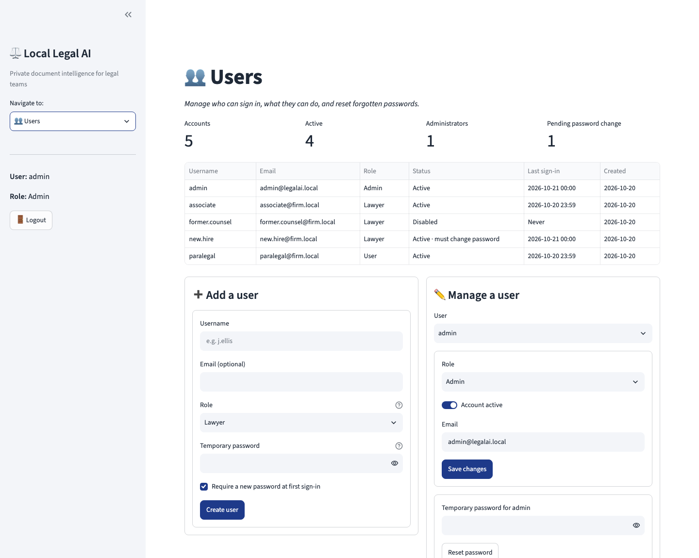

### Integrations (admins)
**Watched inbox:** drop PDF, DOCX or TXT files into `data/inbox/` — or
`data/inbox/<category>/` — and they're indexed within seconds, then moved to
`processed/` (or `failed/` with an explanation). **Notifications:** uploads,
deletions, user changes and security events are sent to n8n (HMAC-signed) and/or
Slack — metadata only, never document text or questions. Three ready-made n8n
workflows (Slack alerts, drop-zone ingestion, daily digest) live in
[`workflows/n8n/`](workflows/n8n/README.md).

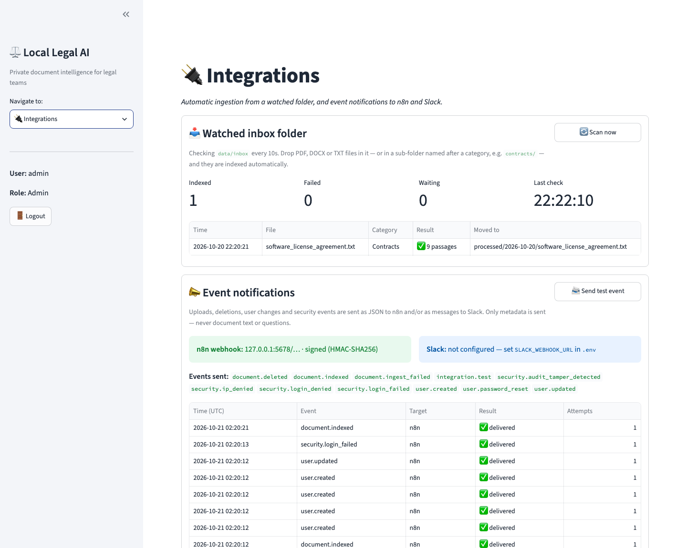

### First sign-in
The default admin password and every temporary password must be replaced before
the rest of the app (and the API) becomes available.

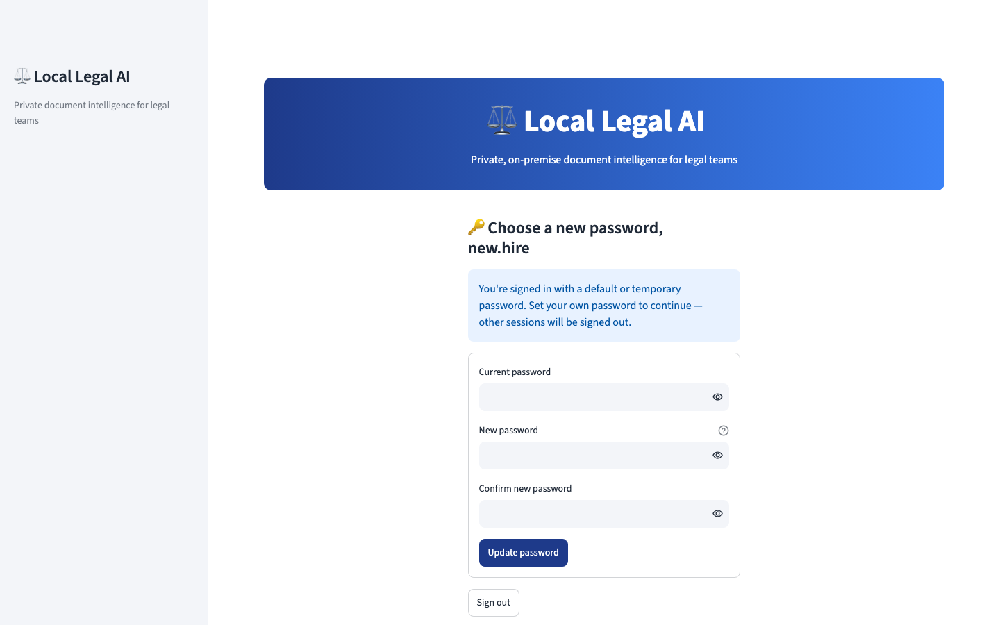

### REST API
Everything in the UI is available over a documented, token-protected API at
`http://localhost:8000/docs`.

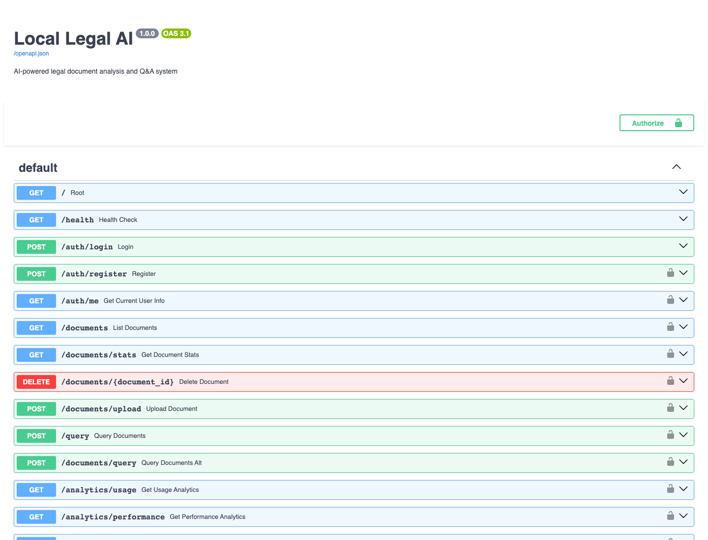

## 🧱 Architecture

```
Browser ─▶ Streamlit UI :8501 ─▶ FastAPI :8000 ─▶ RAG pipeline ─▶ ChromaDB (data/chroma_db)
                                   │      ▲            │
            data/inbox/ (watched) ─┘      │            ▼
                                          │   Local LLM, OpenAI-compatible (vLLM :8001 / Ollama :11434)
                                          │
              signed events ─▶ n8n :5678 ─┴─ drop-zone uploads, daily digest ─▶ Slack
```

Details, endpoint list and data flow: [`docs/ARCHITECTURE.md`](docs/ARCHITECTURE.md).

## ⚡ Quick Start

Requires Python 3.10–3.12.

```bash
git clone https://github.com/jashankish/local-legal-ai.git
cd local-legal-ai
./start_system.sh
```

On first run the script creates `.venv`, installs dependencies, and writes `.env`
with a randomly generated `SECRET_KEY`. Then open **http://localhost:8501** and
sign in with `admin` / `admin123`. You'll be asked to choose your own password
before anything else is available; after that, add colleagues on the 👥 Users page.

Stop everything with `./stop_system.sh`.

### Or with Docker Compose

```bash
cp .env.example .env            # then set SECRET_KEY to a long random string
docker compose up -d --build                       # API + web UI on 127.0.0.1
docker compose --profile llm up -d --build         # + local model server (llama.cpp, CPU)
docker compose --profile automation up -d --build  # + n8n (see workflows/n8n/)
```

One image serves both the API and the UI. The embedding model is built into the
image so containers need no internet access at runtime, and all state (users,
vector store, audit and analytics databases) lives in the `legal_data` volume.
Drop files into `./inbox/` on the host to have them indexed.

> **Status:** the compose file validates (`docker compose config`) and the exact
> container commands, environment and data layout have been verified against the
> build context, but the images have not yet been built on a Docker host. Please
> report any build issue.

### Connecting a local language model (optional)

Without a model the assistant answers in **extractive mode**: the most relevant
sentences from your documents, each cited. To get generated answers, run any
OpenAI-compatible server and point `.env` at it:

```bash
# Option A — llama.cpp, no GPU needed (CPU or Apple Silicon); works with the default .env
bash model/llamacpp_launcher.sh        # first run builds llama.cpp and downloads a 1 GB model

# Option B — Ollama
ollama pull llama3.1:8b
# .env: MODEL_ENDPOINT=http://localhost:11434  MODEL_NAME=llama3.1:8b

# Option C — vLLM on an NVIDIA GPU (larger models)
bash model/vllm_launcher.sh
# .env: MODEL_ENDPOINT=http://localhost:8001   MODEL_NAME=legal-ai-model
```

`GET /health` reports the model as `healthy` once it is reachable (checked every
30 s, no restart needed), and each answer is labelled with the mode that
produced it. On an M-series MacBook the default 1.5B model starts answering in
about half a second. Larger models give richer answers; any of them works with
the same settings.

### 🧪 Try it with sample data

`samples/` contains fictional agreements — a master services agreement (TXT), a
mutual NDA (DOCX), a commercial lease (PDF), an employment agreement (TXT) and,
in `samples/inbox/`, a software licence for the watched-folder demo. With the
system running:

```bash
.venv/bin/python scripts/seed_demo.py --backend http://127.0.0.1:8000 --inbox-dir data/inbox
```

On a fresh install this replaces the default admin password with
`LegalDemo-2025` (override with `--admin-password`), uploads the samples, drops
the inbox sample into `data/inbox/contracts/`, creates a small team and asks a
handful of typical questions so the analytics, audit, user and integration pages
have data. Use it on a fresh instance only.

| Demo account | Password | Role / state |
|---|---|---|
| `admin` | `LegalDemo-2025` | Admin |
| `associate` | `associate-demo-1` | Lawyer |
| `paralegal` | `paralegal-demo-1` | User |
| `new.hire` | `Welcome-temp-1` | Lawyer, must choose a password at first sign-in |
| `former.counsel` | — | Disabled |

To regenerate the README screenshots from a seeded instance:

```bash
.venv/bin/pip install -r requirements-dev.txt && .venv/bin/python -m playwright install chromium
.venv/bin/python scripts/capture_screenshots.py --ui http://127.0.0.1:8501 --api http://127.0.0.1:8000
```

## 💡 Example Use Cases

- 🔍 "What notice period is required to terminate the MSA?" — answer with clause citations
- 📄 Summarise obligations, fees and governing law across a set of agreements
- 🗂 Keep a searchable, private library of client documents

## 🛡 Security Notes

- Services bind to `127.0.0.1` by default; the login page is not exposed to the network.
- Secrets live only in `.env` (git-ignored). Runtime data (`data/`, `logs/`) is git-ignored.
- Uploads are size-limited (`MAX_FILE_SIZE_MB`); only the uploader or an admin can delete a document.
- Every sign-in, upload, question and deletion is written to a hash-chained audit log
  (`data/audit.db`). Admins can filter it, verify its integrity and export it as CSV
  from the 🛡️ Audit Log page.
- `ALLOWED_IPS` restricts which hosts may call the API (include `127.0.0.1` so the
  local UI keeps working).

## 🧪 Testing

```bash
.venv/bin/python -m pytest tests/
```

The suite drives the API end to end against a temporary data directory, with a
mocked LLM for the generative path. `scripts/ui_smoke.py` renders every UI page
against a running backend and fails on any exception.

## 📂 Repository layout

```
backend/            FastAPI app, auth, analytics, inbox watcher, webhook notifier
rag/                document processing, chunking, RAG pipeline, key-term extraction
vector_store/       embedded ChromaDB wrapper
security/           hash-chained audit log
frontend/           Streamlit UI
model/              local model launchers (llama.cpp, vLLM)
workflows/n8n/      n8n workflows, compose file and setup guide
samples/            fictional agreements for demos
scripts/            demo seeding, UI smoke test, screenshot capture, sample builder
tests/              pytest suite (run with `pytest`)
docs/               architecture, screenshots, historical reports (docs/history/)
legacy/             superseded scripts from earlier phases (not used)
phases.md           delivery history and remaining work
```

## 🧩 Stack

| Layer | Tool |
|---|---|
| Model | Any OpenAI-compatible local server (vLLM, Ollama) |
| Vector store | ChromaDB (embedded) + all-MiniLM-L6-v2 |
| Backend | FastAPI |
| Frontend | Streamlit |
| Document parsing | PyMuPDF, PyPDF2, python-docx |
